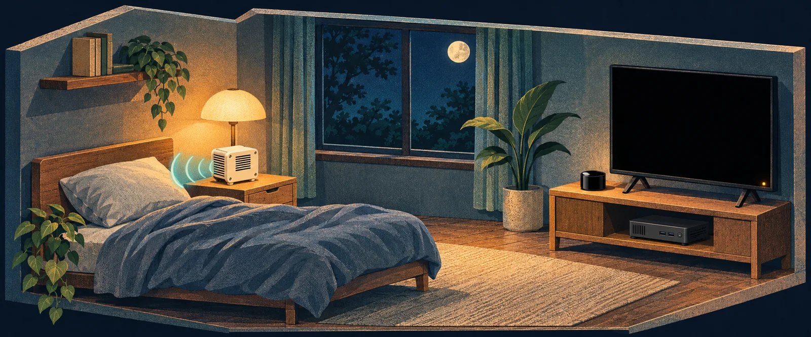
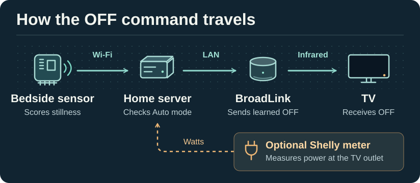
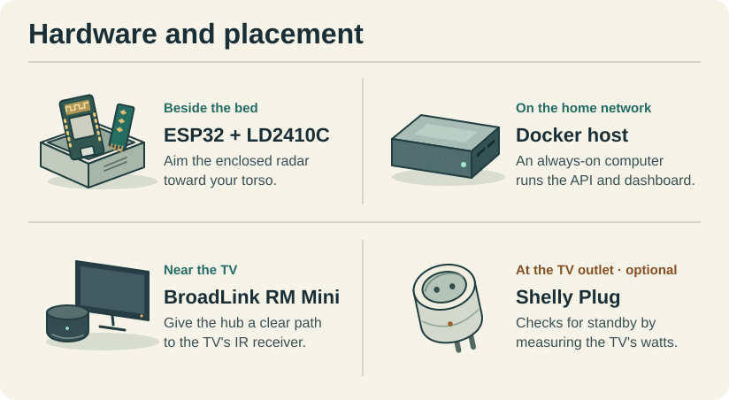
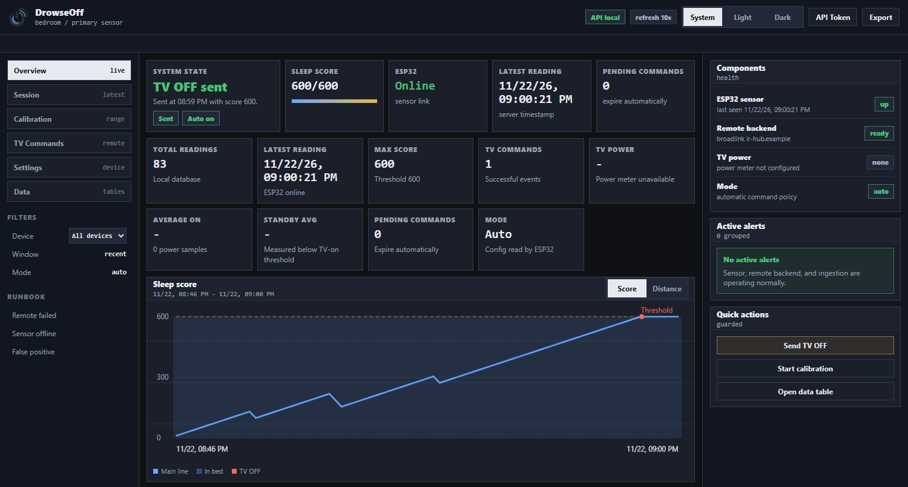

# DrowseOff

<div align="center">
  <picture>
    <source media="(prefers-color-scheme: dark)" srcset="tv-sleep-api/static/brand/drowseoff-logo-dark.png">
    
  </picture>
</div>

DrowseOff turns off an infrared-controlled TV when someone watching from bed has been still for a while. An ESP32 reads a bedside radar, and a self-hosted server asks a BroadLink hub near the TV to send the OFF command. Readings and command history stay on your server in SQLite.



[Quick start](#quick-start) · [Dashboard preview](#dashboard-preview) · [Wiring and placement](docs/hardware.md#main-sensor-wiring) · [API reference](tv-sleep-api/README.md#main-api-endpoints)

## How it decides to turn off the TV



The LD2410C radar measures presence, movement and distance. About once a second, the ESP32 checks whether someone is within the configured bed range. The default is **40–120 cm**.

- A stable distance adds one point. A large change in filtered distance subtracts eight.
- Eight consecutive readings outside the bed range reset the score to zero.
- At **600 points**, the default threshold, Auto mode requests TV OFF. Starting from zero, that takes about **10 minutes** of steady readings. Someone watching quietly while awake can reach the same threshold.
- After an automatic send, another episode can start once the score drops to half the threshold or resets when you leave the bed.

For the BroadLink setup, **Monitor** keeps recording while suppressing automatic OFF. The manual TV control still works. The ESP32 gives each threshold crossing an ID. If the server has already sent OFF, it returns the recorded result when the ESP32 retries. If delivery is uncertain after transmission, the server records that outcome and suppresses another automatic send for that episode.

## Quick start

For the reference build, gather an ESP32 DevKit, an LD2410C radar, four jumper wires, a USB cable for power and programming, a computer running Docker Compose, and a BroadLink IR hub on the same LAN. Place the sensor beside the bed and the hub where its infrared signal can reach the TV. A Shelly power meter is optional.



### 1. Start the server

On the computer that will run DrowseOff, create the local configuration file.

```sh
git clone https://github.com/ChromuSx/DrowseOff.git
cd DrowseOff/tv-sleep-api
cp .env.example .env
```

In `.env`, set `DROWSEOFF_API_TOKEN` to a long random value and `BROADLINK_HOST` to the hub's LAN address. Keep the token handy for the ESP32 and dashboard. Start the service with Docker Compose.

```sh
docker compose up -d --build
```

Open `http://YOUR_SERVER_IP:8010/` and enter the token. In **Settings**, switch **Automatic TV OFF** to **Monitor** while you position the sensor and test the remote.

### 2. Wire and upload the sensor

With USB power disconnected, wire the radar to the ESP32. The radar's **TX goes to GPIO16** and its **RX goes to GPIO17**. Use the wiring diagram to identify the power and ground connections. [Pinout and wiring diagram](docs/hardware.md#main-sensor-wiring)

On the computer running Arduino IDE, open a copy of the repository. From its root, copy the example settings.

```sh
cp firmware/esp32_sleep_sensor/secrets.example.h firmware/esp32_sleep_sensor/secrets.h
```

Set the Wi-Fi name and password, a device ID, the server's LAN URL including port `8010`, and the same API token. In Arduino IDE, install the **esp32** board package by Espressif Systems and the **ld2410** and **IRremoteESP8266** libraries. Open the [sensor sketch](firmware/esp32_sleep_sensor/esp32_sleep_sensor.ino), connect USB, select your board and port, and upload.

Open Serial Monitor at **115200 baud** and look for `Radar: OK`. In the dashboard, check that **Latest reading** advances about every ten seconds. Lie in your usual viewing position and compare the reported distance with the bed range in **Settings**. After a large change to the maximum distance, restart the ESP32 if radar configuration on boot is enabled.

### 3. Teach the hub the OFF command

1. In **TV Commands**, select **Start learning**, aim the TV remote at the BroadLink and press OFF. Select **Save OFF code**. A dedicated OFF command leaves a TV in standby if it receives the signal twice.
2. With the TV on and the remote backend showing **Ready**, select **Turn TV off**, then **Confirm TV OFF**. Check that the screen turns off.
3. When the radar and manual test both work, return to **Settings** and switch **Automatic TV OFF** to **Auto**.

## Dashboard preview



*Example session with simulated readings.* The dips in the chart show where movement lowered the score. The red dot marks the OFF event. **TV OFF sent** records transmission through the hub. With a compatible power meter, **TV OFF confirmed** means the server also observed standby consumption.

## Hardware options and reference

| What you want to do | Where to look |
| --- | --- |
| Build the bedside sensor or adjust its aim | [Parts, wiring and placement](docs/hardware.md) |
| Use a wired IR emitter on the ESP32 | [Direct IR wiring](docs/hardware.md#optional-direct-ir-wiring). For automatic BroadLink control, keep `esp32_ir_auto_enabled=0`. |
| Check whether the TV is already off and verify standby after a send | [Optional Shelly power meter](tv-sleep-api/README.md#shelly-power-meter). To run without a meter, set `DROWSEOFF_POWER_METER_PROVIDER=none`. |
| Configure Docker, authentication or the BroadLink hub | [Server configuration](tv-sleep-api/README.md#configuration) and [example settings](tv-sleep-api/.env.example) |
| Export readings, events, commands and power samples, or integrate Home Assistant | [API endpoints](tv-sleep-api/README.md#main-api-endpoints) and [Home Assistant example](tv-sleep-api/README.md#home-assistant) |

Run the API on a trusted LAN. For access from outside your network, use TLS and access controls. Keep `.env`, `secrets.h`, the database and the learned IR code private. Arduino OTA is disabled by default.

## Contributing

Issues, build reports and pull requests are welcome. For placement problems, include the configured bed range and a few anonymized readings. Ideas for future work include additional remote providers, Home Assistant discovery, calibration charts, failure notifications and multi-room presets. Keep public code, UI text and documentation in English.

Support the project through [GitHub Sponsors](https://github.com/sponsors/ChromuSx), [Ko-fi](https://ko-fi.com/chromus), [Buy Me a Coffee](https://buymeacoffee.com/chromus) or [PayPal](https://www.paypal.com/paypalme/giovanniguarino1999).
