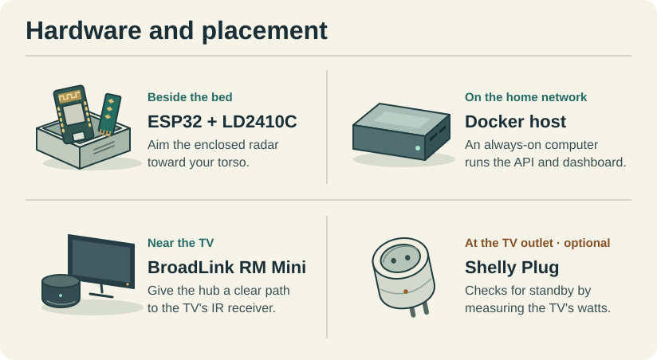
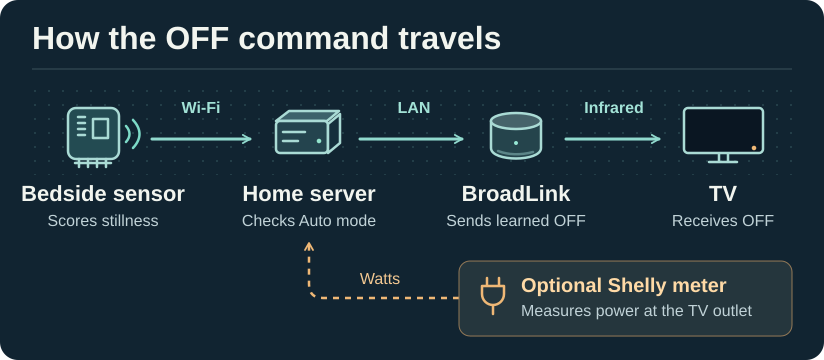
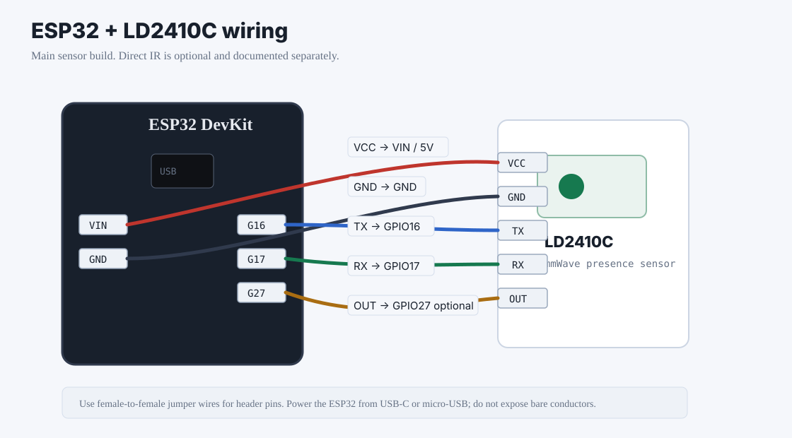
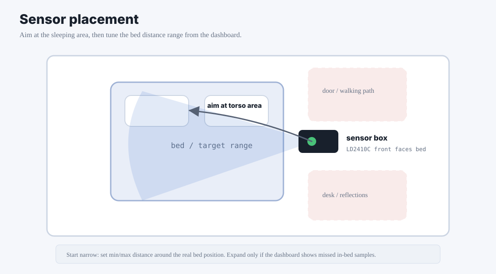

# DrowseOff Hardware Guide

This guide documents the reference hardware build for DrowseOff and the most
common alternatives. It is written for beginners and for contributors who want
to adapt the project to different rooms or remote-control hardware.

## Reference Build

The tested network-hub setup separates sensing from TV control. The ESP32 and
LD2410C sit near the bed, the API runs on a local server, and a BroadLink IR
hub sits within sight of the TV. A Shelly plug can optionally measure power at
the TV outlet.

With a separate hub, you can aim the radar at the bed and place the IR sender
where its signal reaches the TV.

## Build Profiles

All profiles below use the bedside sensor and the local API.

| Profile | Additional hardware | What it does |
| --- | --- | --- |
| Monitor only | None | Records stillness and distance for monitoring and calibration. |
| Network IR | BroadLink IR hub and the TV remote for learning | Sends the learned OFF command from a spot near the TV. |
| Direct IR | IR emitter wired to the ESP32 | Sends the Samsung code in the sketch. Other TV codes require a firmware change. |
| Network IR with standby verification | BroadLink IR hub plus a compatible Shelly power meter | Checks TV power before an automatic hub command and verifies standby after a hub send. |

## Bill of Materials

| Component | When you need it | Selection notes |
| --- | --- | --- |
| ESP32 development board and LD2410C radar | All profiles using the included firmware | The pinout below is for the ESP32 DevKit. Check UART availability, pin assignments and radar protocol before substituting a board or sensor. |
| USB data cable and jumper wires | Programming, power and radar wiring | Match the cable to the board and the wires to your headers. A soldered harness also works. |
| Local server | All profiles using the dashboard | Any always-on computer that can run the API. The setup guide uses Docker Compose. |
| Small plastic enclosure | Optional | An electronics box or 3D-printed case protects the bedside sensor. |
| Network IR hub | Network IR profiles | The included driver learns and sends IR with a BroadLink hub. Other makes need their own integration. |
| Direct IR emitter | Direct IR profile | Wire a suitable 38 kHz transmitter module to the ESP32 and check that the TV responds to its code. |
| Plug-in power meter | Optional standby verification | The included driver reads wattage from a Shelly plug with the local RPC interface, such as the Shelly Plug S Gen3. |

Official/reference pages:

- ESP32 DevKitC overview: <https://www.espressif.com/en/products/devkits/esp32-devkitc/overview>
- LD2410C product page: <https://www.hlktech.net/index.php?id=1095>
- BroadLink downloads/manuals: <https://www.ibroadlink.com/downloads>
- Shelly Plug S MTR Gen3 knowledge base: <https://kb.shelly.cloud/knowledge-base/shelly-plug-s-mtr-gen3>

## Main Sensor Wiring

| LD2410C pin | ESP32 pin | Notes |
| --- | --- | --- |
| `VCC` | `VIN` / `5V` | Power from the ESP32 USB supply |
| `GND` | `GND` | Common ground |
| `TX` | `GPIO16` | Sensor transmit to ESP32 receive |
| `RX` | `GPIO17` | Sensor receive from ESP32 transmit |
| `OUT` | `GPIO27` | Optional digital presence output |

The firmware currently uses UART data from `TX`/`RX` for distance, movement,
stillness, and energy values. The `OUT` pin is useful for simple hardware tests
but is not enough for the full DrowseOff scoring logic.

## Optional Direct IR Wiring

For TV control without a network hub, wire an IR emitter to the ESP32 and set
`DROWSEOFF_REMOTE_PROVIDER=esp32_ir` on the server. The sketch's
`sendTvPower()` sends the 32-bit Samsung code `0xE0E019E6`. If your TV uses
another code or protocol, update that function and upload the adapted sketch.

| IR module pin | ESP32 pin | Notes |
| --- | --- | --- |
| `VCC` | `3V3` | Some modules also accept 5V; check yours |
| `GND` | `GND` | Common ground |
| `DAT` / `SIG` | `GPIO23` | IR send pin used by the firmware |

Small ready-made IR transmitter modules often work only at short range. If the
TV is far from the bed, use a remote hub near the TV or a stronger transistor
driver circuit.

## Placement

Start with the sensor near the bed, aimed at the torso area rather than at the
whole room. Use the dashboard calibration tools to narrow the valid distance
range. A narrower range usually reduces false positives from doors, desks,
walking paths, and reflected movement.

Good placement habits:

- keep the sensor stable and fixed in one position;
- point the LD2410C front face toward the bed;
- avoid aiming directly at doors, fans, curtains, or busy walking paths;
- start with a narrow bed range and expand only if in-bed readings are missed;
- restart the ESP32 after large `distance_max_cm` changes when radar boot
  configuration is enabled.

## Assembly Checklist

1. Connect the ESP32 and LD2410C on the bench.
2. Upload the firmware from Arduino IDE.
3. Open Serial Monitor and verify `Radar: OK`.
4. Start the local API and dashboard.
5. Confirm the dashboard receives live readings.
6. Place the sensor near the bed and run calibration.
7. For monitoring alone, leave **Automatic TV OFF** in **Monitor**. For TV control, learn the OFF command on the BroadLink hub or aim the wired emitter at the TV.
8. If you added a power meter, verify that `TV power` changes between TV on and standby.
9. If you added TV control, run a manual **Turn TV off** test and check that the TV enters standby before enabling **Auto**.

## Public Photo Policy

Real photos are welcome, but only when they are safe to publish:

- use your own photos, or images with a clear license that allows reuse;
- do not copy marketplace images unless their license explicitly allows it;
- avoid visible Wi-Fi names, serial numbers, QR codes, room details, or account
  information;
- prefer clean bench photos over private bedroom photos;
- keep product/vendor photos as links when licensing is unclear.

Suggested future photo slots:

- `docs/assets/photos/sensor-box.jpg` - finished ESP32/LD2410C enclosure;
- `docs/assets/photos/bench-wiring.jpg` - wiring before closing the box;
- `docs/assets/photos/remote-hub-placement.jpg` - generic BroadLink placement;
- `docs/assets/photos/shelly-meter.jpg` - Shelly plug installed without private
  labels visible.

## Troubleshooting

| Symptom | Likely cause | What to check |
| --- | --- | --- |
| Always detects presence | Range too wide, reflections, sensor aimed at room traffic | Narrow distance range, rotate sensor, test away from doors |
| Sleep score never rises | Person not inside configured bed range | Use calibration and check filtered distance |
| TV OFF command sent but TV remains on | Remote hub position or learned code issue | Move hub closer, relearn OFF, check power alert |
| Power meter says TV is always on | Threshold too low or TV standby is high | Compare on/standby wattage and adjust `SHELLY_ON_THRESHOLD_W` |
| ESP32 offline | Wi-Fi, API token, server URL, or power issue | Serial Monitor, dashboard component status, `/api/health` |
